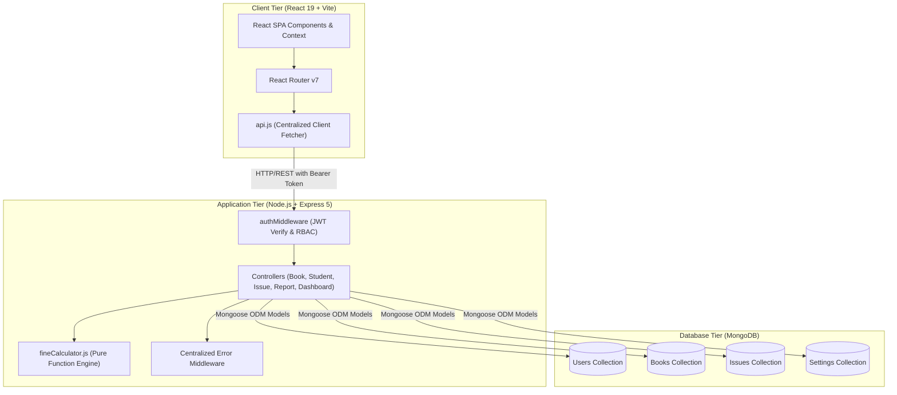
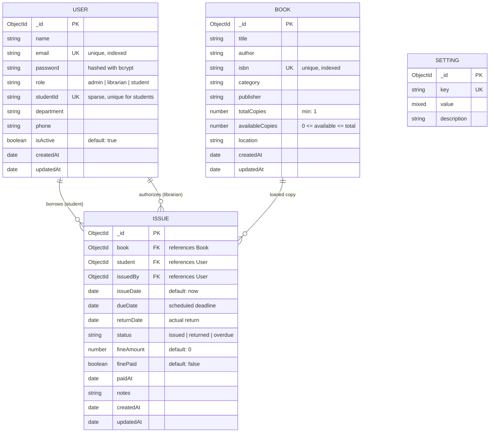
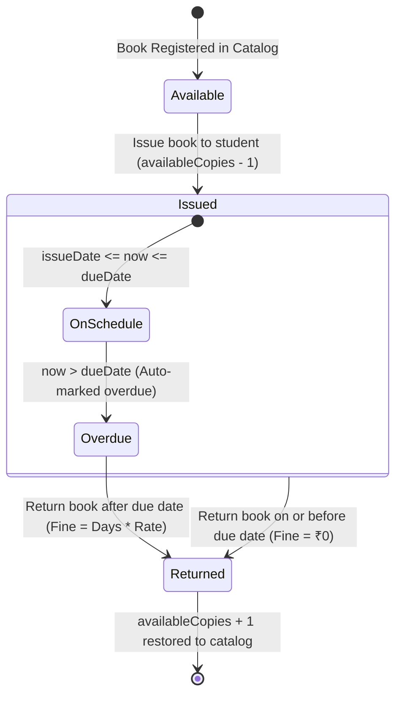

# System Architecture Documentation
## College Library Management System (lib-LMS)

---

### 1. High-Level Architecture Overview

The College Library Management System is architected following the standard three-tier MERN (MongoDB, Express.js, React, Node.js) design pattern:



---

### 2. Entity-Relationship Diagram (ERD)



---

### 3. Circulation Lifecycle & Concurrency Control

To prevent race conditions during book checkout, the system uses MongoDB's atomic operator `$inc` with a precondition query:

```javascript
// Atomic inventory reduction preventing negative stock under concurrent requests
const book = await Book.findOneAndUpdate(
  { _id: bookId, availableCopies: { $gt: 0 } },
  { $inc: { availableCopies: -1 } },
  { returnDocument: 'after' }
);
```

#### Circulation State Transition Diagram:



---

### 4. RESTful API Endpoint Matrix

| Method | Endpoint | Access Role | Description |
| :--- | :--- | :--- | :--- |
| `POST` | `/api/auth/login` | Public | Authenticates credentials and issues signed JWT |
| `GET` | `/api/auth/me` | Authenticated | Retrieves current authenticated user profile |
| `PUT` | `/api/auth/profile` | Authenticated | Updates contact details and department |
| `GET` | `/api/books` | Authenticated | Searches and filters catalog with category and availability |
| `GET` | `/api/books/:id` | Authenticated | Detailed book view with loan history count |
| `POST` | `/api/books` | Admin, Librarian | Registers new book title into catalog |
| `PUT` | `/api/books/:id` | Admin, Librarian | Updates book metadata and safe copy counts |
| `DELETE` | `/api/books/:id` | Admin, Librarian | Removes book (blocked if active loans exist) |
| `GET` | `/api/students` | Admin, Librarian | Searches and filters registered students |
| `POST` | `/api/students` | Admin, Librarian | Registers student account with generated password |
| `PUT` | `/api/students/:id` | Admin, Librarian | Updates student details |
| `PATCH` | `/api/students/:id/status`| Admin, Librarian | Toggles student account between Active and Inactive |
| `GET` | `/api/issues` | Admin, Librarian | Lists issues with filters (All, Issued, Overdue, Returned)|
| `POST` | `/api/issues` | Admin, Librarian | Issues an available book copy to an active student |
| `POST` | `/api/issues/:id/return`| Admin, Librarian | Processes return and calculates overdue fine |
| `GET` | `/api/issues/my-loans` | Student | Student self-service view of active books and fines |
| `GET` | `/api/issues/fines` | Admin, Librarian | Retrieves fines ledger with pending/paid filters |
| `PATCH` | `/api/issues/:id/pay-fine`| Admin, Librarian | Records fine payment receipt |
| `GET` | `/api/dashboard/stats` | Admin, Librarian | Aggregated KPI stats and recent activity stream |
| `GET` | `/api/reports` | Admin, Librarian | Date-bounded and category-filtered audit report |
| `GET` | `/api/health` | Public | Operational heartbeat monitor |
