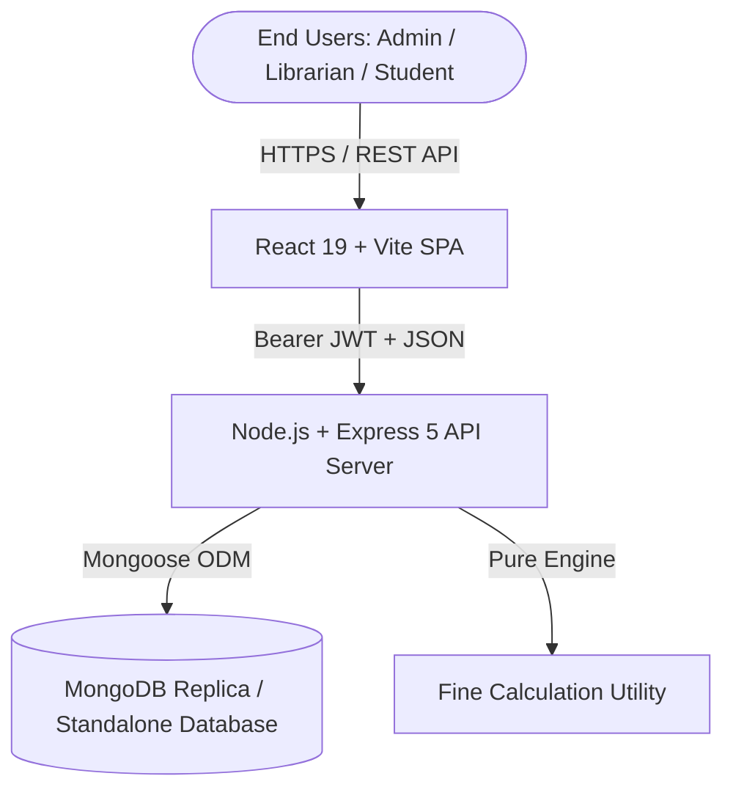

# Software Requirements Specification (SRS)
## College Library Management System (lib-LMS)

---

### 1. Introduction

#### 1.1 Purpose
This Software Requirements Specification (SRS) defines the functional and non-functional requirements for the **College Library Management System (lib-LMS)**. It describes the complete operational requirements, user roles, system behavior, data constraints, and interface specifications for automating circulation desks, catalog management, student registries, and overdue fine administration in collegiate academic institutions.

#### 1.2 Document Conventions
- **MUST / SHALL**: Mandatory requirement.
- **SHOULD**: High-priority recommended capability.
- **MAY**: Optional or auxiliary feature.
- Requirements identifiers follow the format: `[REQ-CAT-XXX]`, where `CAT` denotes the functional subsystem (`AUTH`, `BOOK`, `STUD`, `CIRC`, `FINE`, `REP`).

#### 1.3 Intended Audience
- Software Engineers and Full-Stack Developers
- Academic Librarians and Circulation Desk Staff
- College IT Administrators
- Quality Assurance and Software Testing Engineers
- Academic Auditors and Project Reviewers

#### 1.4 Project Scope
The College Library Management System is a centralized, role-based web application engineered to replace manual paper ledgers and legacy spreadsheet systems. The system provides real-time book catalog tracking, atomic book loan checkouts, return processing with automatic overdue fine computation, student account controls, and analytical audit reporting.

#### 1.5 References
- IEEE Std 830-1998: IEEE Recommended Practice for Software Requirements Specifications.
- RFC 7519: JSON Web Token (JWT) Standard.
- NIST Special Publication 800-63B: Digital Identity Guidelines (Authentication & Password Storage).

---

### 2. Overall Description

#### 2.1 Product Perspective
The system operates as a modern client-server web architecture comprising a single-page React frontend, an asynchronous Node.js/Express RESTful application tier, and a document-oriented MongoDB database.

#### 2.2 Product Functions
1. **Security & RBAC**: Secure credential authentication via bcryptjs, stateless session tokens, and route authorization.
2. **Catalog Administration**: ISBN deduplication, copy bounds enforcement, search indexing, and real-time inventory tracking.
3. **Student Directory**: Student ID tracking, department segmentation, and active/inactive borrowing eligibility toggle.
4. **Circulation Engine**: Concurrent issue checkout with atomic stock decrement, return processing, and overdue tracking.
5. **Overdue Fine Engine**: Daily rate multiplication, threshold boundaries, payment status tracking, and duplicate assessment protection.
6. **Audit & Analytics**: Role-customized dashboard KPIs, overdue warnings, date-filtered circulation ledgers, and printable reports.

#### 2.3 User Classes and Characteristics

| User Role | Responsibilities & Access Privileges |
| :--- | :--- |
| **System Administrator** | Full administrative rights. Manages user roles, system configurations, audits, books, students, and fines. |
| **Librarian** | Daily circulation desk operations. Issues books, processes returns, manages catalog copies, registers students, collects fines, generates reports. |
| **Student** | Read-only catalog exploration, self-service loan tracking, countdown to due dates, fine liability visibility. |

#### 2.4 Operating Environment
- **Server Platform**: Node.js v18+ on Linux, macOS, or Windows Server.
- **Database Engine**: MongoDB v6.0+ (Local or Atlas managed cluster).
- **Client Browsers**: Modern evergreen browsers (Chrome 100+, Firefox 100+, Safari 15+, Edge 100+).

---

### 3. System Features & Functional Requirements

#### 3.1 Authentication & Role-Based Access Control (RBAC)
- **[REQ-AUTH-001]**: The system SHALL authenticate users using an institutional email address and password.
- **[REQ-AUTH-002]**: User passwords SHALL be salted and hashed with bcryptjs using a minimum salt work factor of 10 prior to persistence.
- **[REQ-AUTH-003]**: Passwords and cryptographic password hashes SHALL NEVER be returned in API response bodies.
- **[REQ-AUTH-004]**: Upon valid credentials submission, the system SHALL issue a signed, cryptographically verified JSON Web Token (JWT) encapsulating user ID and assigned role.
- **[REQ-AUTH-005]**: Deactivated accounts SHALL be blocked from authenticating or performing circulation actions with HTTP 403 Forbidden.

#### 3.2 Book Catalog Management
- **[REQ-BOOK-001]**: The system SHALL store book attributes: Title, Author, ISBN, Category, Publisher, Total Copies, Available Copies, and Physical Shelf Location.
- **[REQ-BOOK-002]**: ISBN codes SHALL be unique, uppercase normalized, and indexed for rapid exact-match queries.
- **[REQ-BOOK-003]**: The system SHALL reject any book record where `availableCopies` exceeds `totalCopies` or where copies are negative.
- **[REQ-BOOK-004]**: Catalog searches SHALL support multi-field querying across title, author, category, and ISBN.
- **[REQ-BOOK-005]**: Deleting a book SHALL be strictly blocked if there are active loans currently checked out.

#### 3.3 Student Management
- **[REQ-STUD-001]**: The system SHALL store student profile data: Full Name, Institutional Email, Student ID, Department, Contact Phone, and Account Status (`isActive`).
- **[REQ-STUD-002]**: Institutional email and Student ID SHALL be strictly unique across all student records.
- **[REQ-STUD-003]**: Librarians and Admins SHALL have the ability to toggle a student's active status. Deactivated students SHALL be rejected from receiving new book checkouts.

#### 3.4 Book Circulation (Issue & Return Management)
- **[REQ-CIRC-001]**: The system SHALL allow issuing books only when `availableCopies > 0` and the student account is active.
- **[REQ-CIRC-002]**: Book inventory decrements SHALL be executed atomically to guarantee concurrency safety without race conditions.
- **[REQ-CIRC-003]**: The system SHALL prevent a student from borrowing more than 5 books concurrently.
- **[REQ-CIRC-004]**: The system SHALL prevent issuing a duplicate copy of a book to a student who already has that title checked out.
- **[REQ-CIRC-005]**: Upon processing a return, the system SHALL increment `availableCopies` by 1 and record the return timestamp.

#### 3.5 Fine Calculation & Management
- **[REQ-FINE-001]**: The system SHALL compute overdue fines using the formula:  
  $$\text{Fine} = \max(0, \lfloor\text{Days Overdue}\rfloor \times \text{Daily Rate})$$
- **[REQ-FINE-002]**: Loans returned on or before the calendar due date SHALL incur ₹0 fine.
- **[REQ-FINE-003]**: The fine calculation engine SHALL normalize dates to midnight boundaries to avoid unfair sub-day partial penalties.
- **[REQ-FINE-004]**: Circulation staff SHALL be permitted to collect fines immediately at return time or leave them as pending liabilities.

#### 3.6 Reports & Printable Analytics
- **[REQ-REP-001]**: The system SHALL support circulation ledger reports filtered by report type: All Loans, Currently Issued, Returned, Overdue, and Fines.
- **[REQ-REP-002]**: The system SHALL support date range boundaries (`fromDate` and `toDate`) and department filtering.
- **[REQ-REP-003]**: The report interface SHALL offer an optimized CSS `@media print` layout hiding navigation and sidebars for clean printing.

---

### 4. Non-Functional Requirements

#### 4.1 Performance Requirements
- **[NFR-PERF-001]**: API response times for catalog search and dashboard metrics SHALL be under 200ms under standard local load.
- **[NFR-PERF-002]**: Database queries on ISBN, Student ID, and Loan Status SHALL utilize compound B-Tree indexes.

#### 4.2 Security Requirements
- **[NFR-SEC-001]**: All state-modifying endpoints (`POST`, `PUT`, `DELETE`, `PATCH`) SHALL require verified JWT tokens and explicit role authorization.
- **[NFR-SEC-002]**: Input parameters SHALL be sanitized, trimmed, and validated against schema invariants.

#### 4.3 Data Integrity & Concurrency
- **[NFR-INT-001]**: Stock availability checks and decrements MUST use atomic MongoDB operations (`findOneAndUpdate` with `$inc` and precondition `availableCopies > 0`) to prevent overselling inventory.
